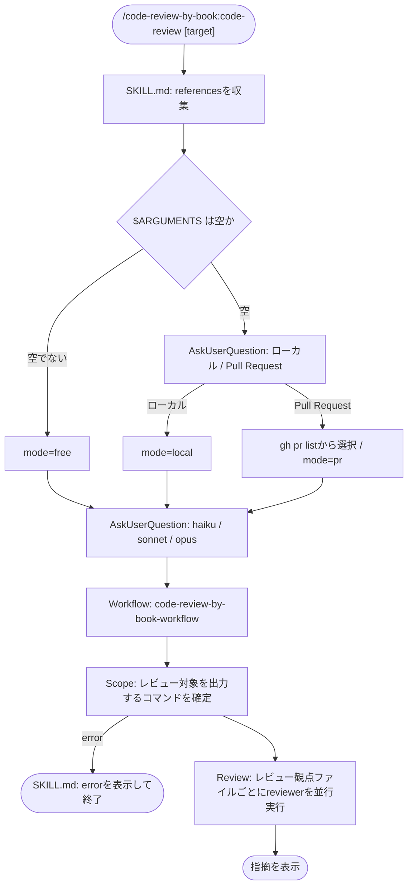
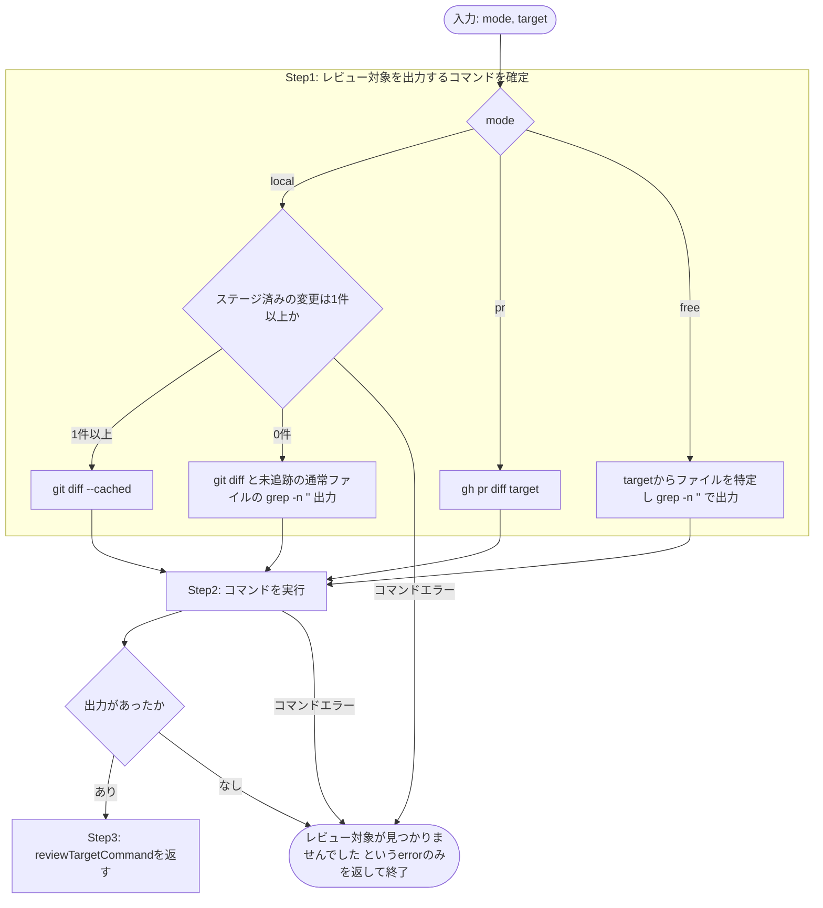

# code-review-by-book

## 概要

- 読んだ技術書ごとにレビュー観点を `references/**/*.md` ファイルとして蓄積
- レビュー観点ファイル1件につき1つのsubagentで並行してレビューを実施

## 前提環境

- `git`
- `gh` (Pull Requestをレビューする場合のみ)

## 提供するskill

| skill         | 説明           |
| ------------- | -------------- |
| `code-review` | レビューを実行 |

`/code-review-by-book:code-review [レビュー対象]` で明示的に呼び出す

### レビュー対象の指定方法

| 指定                                                     | 動作                                     |
| -------------------------------------------------------- | ---------------------------------------- |
| 引数なし                                                 | `AskUserQuestion`で対話形式で指定        |
| 引数あり (ファイル名、ファイルパス)                      | `free` modeとして、そのファイルをレビュー対象にする |

### workflowの引数

| 項目                   | 型       | 必須     | 説明                                                        |
| ---------------------- | -------- | -------- | ----------------------------------------------------------- |
| `mode`                 | string   | 必須     | `local` / `pr` / `free` のいずれか                          |
| `target`               | string   | mode次第 | `pr`はPR番号、`free`はファイル名またはファイルパス         |
| `reviewViewpointFiles` | string[] | 必須     | `references/**/*.md` の絶対パス一覧                         |
| `model`                | string   | 必須     | reviewerに使うmodel、`haiku` / `sonnet` / `opus` のいずれか |

## 処理フロー

### scope-collector agentの処理フロー

`agents/scope-collector.md` の処理を表す

## ファイル構成

| ファイル                                | 役割                                            |
| --------------------------------------- | ----------------------------------------------- |
| `skills/code-review/SKILL.md`           | `workflows/code-review.js` を実行               |
| `skills/code-review/references/**/*.md` | レビュー観点ファイル                            |
| `workflows/code-review.js`              | Scope → Review の順でagentを実行                |
| `agents/scope-collector.md`             | レビュー対象を出力するコマンドを確定するagent   |
| `agents/reviewer.md`                    | レビュー観点ファイルごとに並行レビューするagent |
