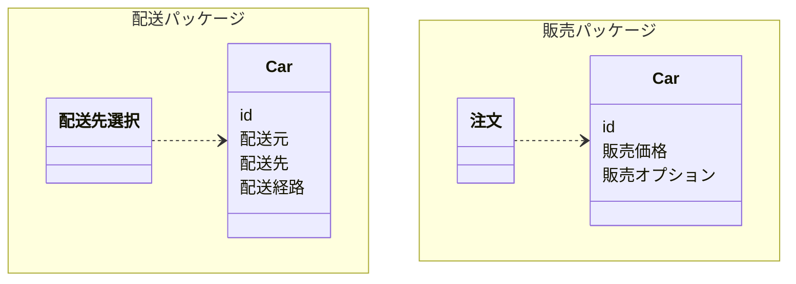

## 名前設計 (目的駆動)

可能な限り具体的で意味が狭い目的に特化した命名をすること

アカウント名、表示名、本命、法人名など目的に応じて分けること

- NG
  - 商品
- OK
  - 予約品
  - 注文品
  - 在庫品
  - 発送品

## NG 存在駆動

ユーザー名のみ、人間1人=名前は1つという考え方はNG

## OK 仕様変更時に命名も再考慮し必要に応じてリネームすること

例えば、初期は `個人顧客` のみ扱い、1つのクラスで扱っていた

仕様変更で `法人顧客` も扱うことにした

その場合は、`個人顧客` と `法人顧客` クラスに分けて、クラス名なども再考慮する

## NG アンカリング効果

既存のコードの誤った数値や命名を基準に新しいコードも誤った数値や命名にしてしまうこと

例えば、既存のコードを確認する上で、クラスが何の目的のために何をやっているか確認し、そもそも適切な名前なのか確認すること

## NG 形容詞を含めた命名に注意

必要に応じてクラスとして分離したほうが良い可能性が高い

以下例

- このフラグが立っている時のUserは **要注意会員**
- この行のpriceは **新品価格** で次の行のpriceは **中古価格**
- Ticketクラスは年齢が60歳以上なら **シニア料金用** になりさらに平日なら **平日のシニア料金用** になる

## NG 意図が分からない名前

スコープが数行であり理解可能であればOKだが基本的にNG

```java
int tmp3 = tmp1 - tmp2;
```

## NG 技術駆動命名

以下のような命名は含むべきではない

- コンピュータ由来: memory, cache, thread, register...
- プログラミング由来: function, method, class, module...
- 型名由来: int, str(string), flag(bool)...

```java
class MemoryStateManager {
  void changeIntValue01(int changeValue) {
    intValue01 -= changeValue;
    if (intValue01 < 0) {
      intValue01 = 0;
      updateState02Flag();
    }
  }
  ...
}
```

## NG ロジックの構造をなぞった長い命名

```java
class Magic {
    boolean isMemberHpMoreThanZeroAndIsMemberCanActAndIsMemberMpMoreThanMagicCostMp(Member member) {
        if (0 < member.hitPoint) {
            if (member.canAct()) {
                if (costMagicPoint <= member.magicPoint) {
                    return true;
                }
            }
        }
        return false;
    }
}
```

## OK 目的が分かる命名

```java
class Magic {
    boolean canChant(final Member member) {
        if (member.hitPoint <= 0) return false;
        if (!member.canAct()) return false;
        if (member.magicPoint < costMagicPoint) return false;
        return true;
    }
}
```

## NG 命名から分からない複雑な処理がある

```java
class Order {
    private final OrderId id;
    private final Items items;
    private GiftPoint giftPoint;
    int itemCount() {
        int count = items.count();
        // 注文商品数が10個以上ならお買い物ギフトポイントを100追加する。
        // この処理はitemCountという命名からは分からない
        if (10 <= count) {
            giftPoint = giftPoint.add(new GiftPoint(100));
        }
        return count;
    }
}
```

## OK 命名から分かるように処理を分割

```java
class Order {
    private final OrderId id;
    private final Items items;
    private GiftPoint giftPoint;
    int itemCount() {
        return items.count();
    }
    boolean shouldAddGiftPoint() {
        return 10 <= itemCount();
    }
    void tryAddGiftPoint() {
        if (shouldAddGiftPoint()) {
            giftPoint = giftPoint.add(new GiftPoint(100));
        }
    }
}
```

## OK DTO (Data Transfer Object)

参照用であり計算やデータ変更を行わない場合は、fieldのみのクラスを定義してよい

## NG 巨大化しそうな命名 Manager、Processor、Controller

目的に応じて最初から適切な命名にしておくべき

Managerクラスを作ってしまうと後から多くの関係のないロジックが1つにまとめられてしまう恐れがある

## NG 文脈によって意味や扱いが異なる名前

Carについて2つの文脈がある

そのため2つのパッケージに分けて定義



## NG 連番命名

```java
class Class001 {
  void method001();
  void method002();
  void method003();
  ...
}
```

## NG 動詞 + 目的語の命名に注意

```java
class Enemy {
    boolean isAppeared;
    int magicPoint;
    Item dropItem;

    void escape() {
        isAppeared = false;
    }

    void consumeMagicPoint(int costMagicPoint) {
        magicPoint -= costMagicPoint;
        if (magicPoint < 0) {
            magicPoint = 0;
        }
    }

    // NG
    boolean addItemToParty(List<Item> items) {
        if (items.size() < 99) {
            items.add(dropItem);
            return true;
        }
        return false;
    }
}
```

## OK 目的語をクラスにし、動詞をメソッドとして追加

```java
class PartyItems {
    static final int MAX_ITEM_COUNT = 99;
    final List<Item> items;

    PartyItems() {
        items = new ArrayList<>();
    }

    private PartyItems(List<Item> items) {
        this.items = items;
    }

    PartyItems add(final Item newItem) {
        if (items.size() == MAX_ITEM_COUNT) {
            throw new RuntimeException("これ以上アイテムを持てません。");
        }

        final List<Item> adding = new ArrayList<>(items);
        adding.add(newItem);
        return new PartyItems(adding);
    }
}
```

## NG クラス名 is xxx が英文として成立しない

`Common is member in confusion` は成立しない

`boolean` の扱い方が適切でない場合に起こりやすい

```java
class Common {
    static boolean isMemberInConfusion(Member member) {
        return member.states.contains(StateType.confused);
    }
}
```

## OK クラス名 is xxx が英文として成立する

```java
class Member {
    private final States states;
    boolean isInConfusion() {
        return states.contains(StateType.confused);
    }
}
```

## NG 名前の省略

意味が分からない

```java
int trFee = brFee + LRF * dod;
```

存在しない略語

AWS EventBridgeをEBと略するのは公式ではないためNG

```typescript
import * as events from 'aws-cdk-lib/aws-events';

// eventBusと素直に記載すべき
const ebBus = new events.EventBus(this, 'MyEventBus', {
  eventBusName: 'my-custom-event-bus',
});
```

## OK 公式で定義されている省略

SNS (Simple Notification Service) はAWS公式で省略表記されているためOK

```typescript
import * as sns from 'aws-cdk-lib/aws-sns';

const snsTopic = new sns.Topic(this, 'MyTopic', {
  topicName: 'my-notification-topic',
  displayName: 'マイ通知トピック',
});

```
