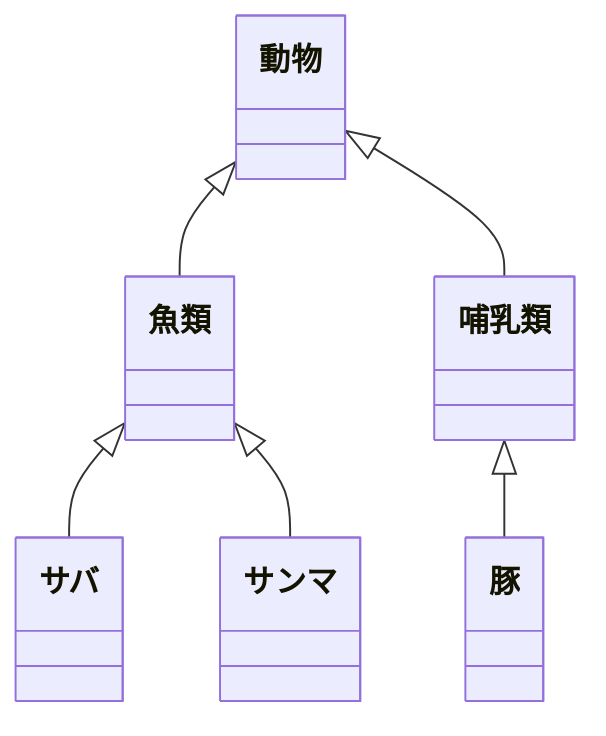
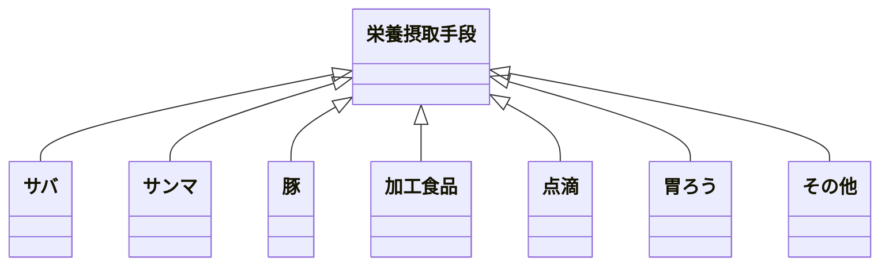

# モデリングのレビュー観点

- NG 1つの特定の目的達成のために最低限考慮が必要な要素を備えたモデルになっていない
- NG 1つの特定の目的に特化して設計されていない
- NG 現実世界での物理的な存在と、情報システム上のモデルが1対1になるとは限らず、1対多の関係になるケースがあるが、そうなっていない
- NG システムはなんらかの目的を達成するためにつくられるのであり、責務よりも目的が先に来ていない
- NG そのモデルが達成しようとしている目的をすべて洗い出されていない
- NG 目的それぞれ特化したモデリングになっていない
- NG 目的駆動名前設計にもとづき、モデルが命名されていない
- NG モデルに目的外の要素が入り込んでいる

## NG 目的が分からないモデル

以下は、`生物学な分類` をしたモデル

## OK 目的が正確なモデル

以下は `栄養摂取手段` を目的にしたモデル

