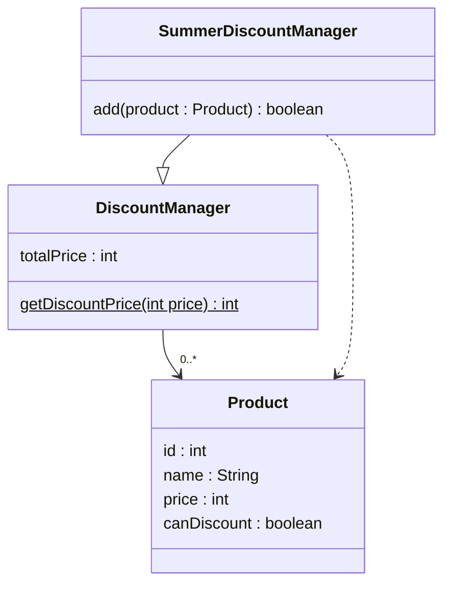
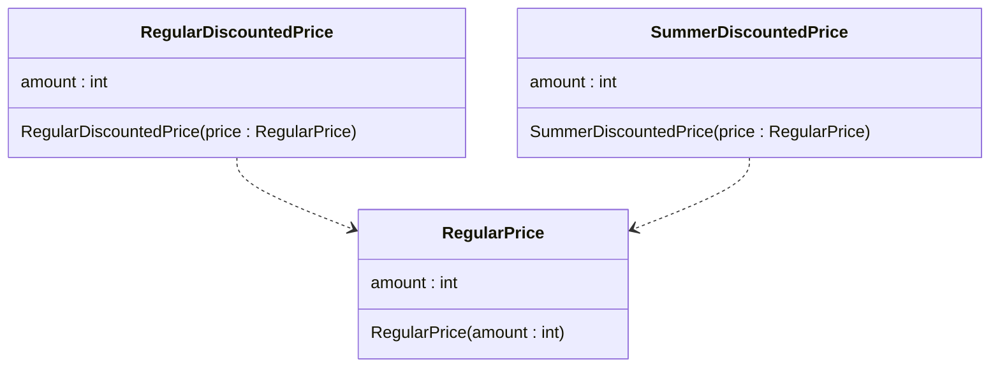

## NG 異なる目的の処理を共通化

ロジックがほぼ同じため、夏季割引の処理を通常割引を流用してしまった

通常割引だけの割引価格を変更することができない状態



## OK 目的が異なる場合は処理がほぼ同じでも共通化すべきではない

ロジックがほぼ同じでも夏季割引と通常割引は依存すべきではない

目的が異なるため、DRY原則は適用されない



## NG 処理の共通化を、継承を利用しoverrideしたところ、thisが意図していないインスタンスを利用している

```typescript
// ------------------------------
// BaseDiscountRuleに会員割引機能が追加することになった
// calcAmountを2回呼ぶことにした
// ------------------------------
class BaseDiscountRule {
  calcAmount(price: number): number {
    return price * 0.1;
  }

  // 会員割引機能: 会員は割引を2回分適用する仕様
  calcMemberAmount(price: number): number {
    return this.calcAmount(price) * 2; // サブクラスのoverrideしたcalcAmountが呼び出されてしまった
  }
}

// VipDiscountRuleは何も変更していない
class VipDiscountRule extends BaseDiscountRule {
  override calcAmount(price: number): number {
    return super.calcAmount(price) + 500;
  }
}

const vip = new VipDiscountRule();

console.log(vip.calcAmount(10000));
console.log(vip.calcMemberAmount(10000));

// 実際の計算過程：
// calcMemberAmount() 内の this.calcAmount(price) は、"this"が vip インスタンスなので、
// VipDiscountRuleでoverrideされたcalcAmount(+500付き)が呼ばれる
// → (1000 + 500) * 2 = 3000
//
// 一見正しく見えるが、意図は「基本割引を2倍にしてからVIP加算」だったのに
// 「VIP加算した後に2倍」になっており、「VIP分も二重に評価される設計ミス」が発生している
```

## OK 処理の共通化は、継承ではなくインターフェイス+コンポジション+委譲を利用すること

継承は、サブクラス側もスーパークラス側も、お互いの実装を意識し続けなければならない状態になるため、リスクが大きく、基本的に避けること

コンポジションにすることでoverrideのリスクをなくしつつ、処理を共通化できる

```typescript
// interfaceを定義
interface DiscountRule {
  calcAmount(price: number): number;
}

// 基本の割引ルールを実装
class BaseDiscountRule implements DiscountRule {
  calcAmount(price: number): number {
    return price * 0.1;
  }
}

// VIP割引ルールを実装
class VipDiscountRule implements DiscountRule {
  // コンポジション: コンストラクタで他のオブジェクトを受け取り変数として持つ
  private base: DiscountRule;

  constructor(base: DiscountRule) {
    this.base = base;
  }

  calcAmount(price: number): number {
    return this.base.calcAmount(price) + 500;
  }
}

// 会員割引ルールを実装
class MemberDiscountRule implements DiscountRule {
  private base: DiscountRule;

  constructor(base: DiscountRule) {
    this.base = base;
  }

  calcAmount(price: number): number {
    // 委譲: 具体的なロジックはコンポジションのオブジェクトから呼び出す
    return this.base.calcAmount(price) * 2;
  }
}

const baseRule: DiscountRule = new BaseDiscountRule();
const vipRule: DiscountRule = new VipDiscountRule(baseRule);
const vipMemberRule: DiscountRule = new MemberDiscountRule(vipRule);
```

## その他 関心が混ざっている

- 不必要にpublicにしない。基本的にはprivateにすること
- 表示と表示以外のロジックは別のクラスに分離すること
