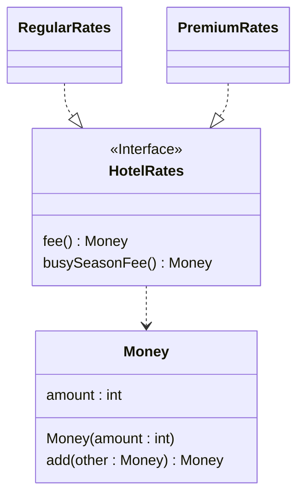

## 概要

ifやswitchに詳細なロジックを記載すべきではない

interfaceとstrategyパターンを利用するとよい

## NG 条件分岐のネスト

```java
if (0 < member.hitPoint) {
  if (member.canAct()) {
    if (magic.costMagicPoint <= member.magicPoint) {
      member.consumeMagicPoint(magic.costMagicPoint);
      member.chant(magic);
    }
  }
}
```

## OK 早期returnでネストを解消

```java
if (member.hitPoint <= 0) return;
if (!member.canAct()) return;
if (member.magicPoint < magic.costMagicPoint) return;

member.consumeMagicPoint(magic.costMagicPoint);
member.chant(magic);
```

## NG elseを多用

```java
float hitPointRate = member.hitPoint / member.maxHitPoint;

HealthCondition currentHealthCondition;
if (hitPointRate == 0) {
  currentHealthCondition = HealthCondition.dead;
}
else if (hitPointRate < 0.3) {
  currentHealthCondition = HealthCondition.danger;
}
else if (hitPointRate < 0.5) {
  currentHealthCondition = HealthCondition.caution;
}
else {
  currentHealthCondition = HealthCondition.fine;
}

return currentHealthCondition;
```

## OK 早期returnでelseを削除

```java
float hitPointRate = member.hitPoint / member.maxHitPoint;

if (hitPointRate == 0) return HealthCondition.dead;
if (hitPointRate < 0.3) return HealthCondition.danger;
if (hitPointRate < 0.5) return HealthCondition.caution;

return HealthCondition.fine;
```

## NG switchの重複

```java
enum ShapeType { CIRCLE, RECTANGLE }

class Shape {
    ShapeType type;
    double radius;
    double width, height;
}

// 面積計算
double calcArea(Shape shape) {
    switch (shape.type) {
        case CIRCLE:
            return Math.PI * shape.radius * shape.radius;
        case RECTANGLE:
            return shape.width * shape.height;
        default:
            throw new IllegalArgumentException("Unknown type");
    }
}

// 周囲長計算 (同じ分岐が再度出現)
double calcPerimeter(Shape shape) {
    switch (shape.type) {
        case CIRCLE:
            return 2 * Math.PI * shape.radius;
        case RECTANGLE:
            return 2 * (shape.width + shape.height);
        default:
            throw new IllegalArgumentException("Unknown type");
    }
}

// 説明文生成 (またも同じ分岐)
String describe(Shape shape) {
    switch (shape.type) {
        case CIRCLE:
            return "Circle r=" + shape.radius;
        case RECTANGLE:
            return "Rectangle " + shape.width + "x" + shape.height;
        default:
            throw new IllegalArgumentException("Unknown type");
    }
}
```

## OK Strategyパターンを利用

同じ条件分岐(ifやswitch)がある場合はstrategyパターンを検討すること

```java
// 1. 種類ごとに切り替えたい処理をinterfaceにまとめて定義
interface Shape {
    double area();
    double perimeter();
    String describe();
}

// 2. 各種類を個別クラスとして実装 (switchのcase一つ一つをクラスにする)
class Circle implements Shape {
    private final double radius;
    Circle(double radius) { this.radius = radius; }
    public double area() { return Math.PI * radius * radius; }
    public double perimeter() { return 2 * Math.PI * radius; }
    public String describe() { return "Circle r=" + radius; }
}

class Rectangle implements Shape {
    private final double width, height;
    Rectangle(double width, double height) { this.width = width; this.height = height; }
    public double area() { return width * height; }
    public double perimeter() { return 2 * (width + height); }
    public String describe() { return "Rectangle " + width + "x" + height; }
}

// 3. 呼び出し側はswitchなしでポリモーフィックに呼べる
void printInfo(Shape shape) {
    System.out.println(shape.describe() + " area=" + shape.area() + " perimeter=" + shape.perimeter());
}
```

## NG 型判定による分岐

```java
Money busySeasonFee;
if (hotelRates instanceof RegularRates) {
  busySeasonFee = hotelRates.fee().add(new Money(3000));
}
else if (hotelRates instanceof PremiumRates) {
  busySeasonFee = hotelRates.fee().add(new Money(5000));
}
```

interfaceを利用すること



## NG フラグ引数

```java
void damage(boolean damageFlag, int damageAmount) {
  if (damageFlag == true) {
    member.hitPoint -= damageAmount;
    if (0 < member.hitPoint) return;

    member.hitPoint = 0;
    member.addState(StateType.dead);
  }
  else {
    member.magicPoint -= damageAmount;
    if (0 < member.magicPoint) return;

    member.magicPoint = 0;
  }
}
```

## OK メソッドを分離し、必要に応じてstrategyパターンを利用

```java
void hitPointDamage(final int damageAmount) {
  member.hitPoint -= damageAmount;
  if (0 < member.hitPoint) return;

  member.hitPoint = 0;
  member.addState(StateType.dead);
}

void magicPointDamage(final int damageAmount) {
  member.magicPoint -= damageAmount;
  if (0 < member.magicPoint) return;

  member.magicPoint = 0;
}
```
